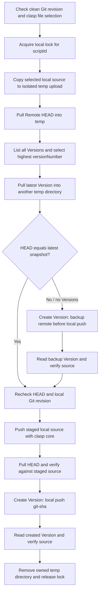

# Apps Script Safe Push + Remote Backup

`npm run push`, `npm run push:test` และ `npm run push:prod` ใช้ [tools/safe-push.cjs](tools/safe-push.cjs) เพื่อสำรอง Remote HEAD ที่ยังไม่มี snapshot ก่อนเขียนทับ และสร้าง Version ของ source หลัง push สำเร็จ

## ใช้งาน

```sh
git add <files>
git commit -m "Describe local changes"
npm run push:check
npm run push
```

`push:check` อ่าน remote และ Versions เพื่อรายงานว่าจะต้อง backup หรือไม่ ไม่มีการสร้าง Version หรือ push ส่วน `push` ดำเนิน flow ทั้งหมด ไม่มีคำถามยืนยัน manifest ระหว่างทาง

```sh
npm run push:test
npm run push:prod
npm run push:test -- --dry-run
node tools/safe-push.cjs --local-check
```

TEST/PROD ต้องมี `.clasp.test.json` / `.clasp.prod.json` ตามเดิม `--local-check` ตรวจการอ่าน config และชุดไฟล์จาก clasp เท่านั้น ไม่อ่าน credentials หรือเรียก Google และอนุญาต dirty worktree เพื่อใช้ตรวจระหว่างพัฒนา

Safe push จริงและ dry-run ต้องมี Git worktree สะอาด รวม untracked files และทุก source ที่อัปโหลดต้อง tracked ใน Git เพื่อให้ `local push <git-sha>` อ้าง source ที่ commit แล้วได้ ค่า Script ID มาจาก config ที่เลือก ใช้ credentials จาก `npm run login` บัญชี default หรือไฟล์ที่กำหนดด้วย `clasp_config_auth`

## Flow



ไม่มี `clasp pull` ลง source directory หลัก และไม่มี `git reset`, `git stash` หรือ restore worktree โดยอัตโนมัติ Source ปัจจุบันอยู่ root ของ repo ได้ ไม่จำเป็นต้องย้ายเข้า `src/` หากย้ายในอนาคต wrapper ใช้ rootDir/srcDir ตาม clasp config

Temp directory ใช้ OS temp (`%TEMP%/clasp-safe-push-*` บน Windows) แยก `local-upload`, `remote-head`, `latest-version`, `backup-version`, `before-push`, `after-push`, `local-version` แต่ละ pull อยู่ใน directory ใหม่ ตรวจ resolved path ก่อน recursive cleanup และ cleanup ใน finally ทั้งกรณีสำเร็จ/ล้มเหลว หาก process ถูก kill อาจเหลือ temp/lock ให้ตรวจเองก่อนลบ

## การ compare

SHA-256 ของ sorted records `(remote filename, file type, source)` ครอบคลุม `.gs`/server JS, `.html` และ `appsscript.json` รวมการเพิ่ม/ลบ/เปลี่ยนชื่อไฟล์

- ไม่ใช้ local path, timestamps หรือ metadata ในการเปรียบเทียบ
- ปรับ CRLF เป็น LF เพื่อให้ Windows/Linux เทียบกันได้
- JSON เปรียบเทียบตามค่าและเรียง object keys แต่รักษาลำดับ array
- JS/HTML รักษา whitespace อื่นและ comments; whitespace ใน template literals จึงไม่ถูก trim ทิ้ง
- Response/manifest ที่เสียรูปแบบ, duplicate names หรือ file types ที่ไม่รองรับ ทำให้หยุด

หากไม่เคยมี Version จะสำรอง HEAD ก่อนเสมอ หากไม่มีพื้นที่พอสำหรับ Version ที่ต้องสร้าง (ปัจจุบัน limit 200 Versions/project) จะหยุดก่อน push ไม่ลบ Version เก่าเอง

## clasp implementation

ตรึง `@google/clasp` ที่ **3.4.1** และใช้ core ที่ CLI รุ่นนี้ใช้จริง: `files.pull()`, `project.listVersions()`, `project.version()` และ `files.push()` พร้อม load credentials ผ่าน auth module ของ clasp ไม่มี OAuth client ใหม่ ไม่มีการคัดลอก token ลง temp

เหตุที่เรียก core push โดยตรง: CLI 3.4.1 อาจ skip manifest update ใน non-interactive mode และตรวจ changed files จาก local list ซึ่งไม่ครอบคลุม deletion-only update ตัว wrapper ส่งชุดไฟล์ staging ทั้งหมด แล้วตรวจ Remote HEAD กลับเสมอ จึงรองรับการลบ remote file ด้วย ไม่ใช้ `--force` และไม่ผ่าน interactive prompt ของ CLI

Core เป็น internal interface จึงมี runtime version guard; หากอัปเกรด clasp ต้องตรวจ adapter และรัน tests ก่อนแก้ pin การเรียก `npx clasp push` โดยตรงยังข้าม safe flow นี้ได้ ให้ใช้ npm scripts เป็นทางปกติ

## Failure และ concurrent edits

- Backup/list/pull ล้มเหลว: หยุดก่อน local upload
- Remote เปลี่ยนก่อน push หรือระหว่าง backup: หยุด ไม่ใช้ snapshot ที่ไม่ตรงกับ HEAD ที่ตรวจไว้
- Push ล้มเหลวหรือผลไม่แน่นอน: ไม่สร้าง local Version ไม่ retry/rollback อัตโนมัติ เพราะ remote อาจเปลี่ยนแล้ว
- Push สำเร็จแต่สร้าง Version ล้มเหลว: รายงาน stage และระบุว่า remote อาจมี local upload แล้ว ตรวจ HEAD/Versions ก่อน rerun
- Version ที่สร้างไม่ตรง local: รายงาน concurrent edit; ไม่รายงาน success
- Lock อยู่ใน Git common directory แยกตาม scriptId จึงกัน wrapper จาก worktrees ของ repo เดียวกัน แต่ไม่กันเครื่องอื่นหรือ Apps Script UI

Apps Script API ไม่มี atomic compare-and-swap ใน flow นี้ การ recheck ลดโอกาสชนกันแต่ยังมีช่องระหว่าง check กับ push ควรใช้ single writer และงดแก้ Apps Script UI ระหว่าง push Snapshot ของ remote ที่ตรวจไว้ยังอยู่ แต่การแก้ใหม่หลัง check อาจไม่ได้ถูกสำรอง

คำอธิบาย `backup remote before local push` บอกว่า source ต่างจาก snapshot ล่าสุด ไม่ได้พิสูจน์ว่าผู้แก้ใช้ UI เพราะอาจมาจาก CLI หรือ API อื่น

## สิ่งที่สำรอง

| ระบบ | หน้าที่ |
| --- | --- |
| Git | source of truth ของ local source ที่ commit แล้ว |
| Apps Script Remote HEAD | source ปัจจุบันที่แก้ไขได้บน Google |
| Apps Script Versions | immutable snapshots ของ script project source |
| Spreadsheet Version History | ประวัติข้อมูลและโครงสร้าง Spreadsheet แยกต่างหาก |

Apps Script Version **ไม่สำรอง** ข้อมูลในชีต, สูตร, formatting, charts, tabs หรือค่าปัจจุบันของ Script Properties เช่น credentials/token การสร้าง Version ไม่ได้สร้างหรืออัปเดต deployment ที่ pin อยู่กับ Version อื่น

## Validation และ references

`npm test` ครอบคลุม same/different/no-version, fail-before-push, concurrent edits, partial completion, version capacity, content hashes และการอ่านไฟล์ staging ด้วย clasp รุ่นที่ pin โดยไม่ติดต่อ Google การยืนยันสิทธิ์และ flow กับ Google จริงต้องใช้ test project ที่พร้อมให้ push

- [projects.getContent](https://developers.google.com/apps-script/api/reference/rest/v1/projects/getContent): ไม่ระบุ versionNumber คือ HEAD; ระบุเลขเพื่ออ่าน snapshot
- [projects.versions.create](https://developers.google.com/apps-script/api/reference/rest/v1/projects.versions/create): สร้าง immutable snapshot จาก source ปัจจุบัน
- [projects.versions.list](https://developers.google.com/apps-script/api/reference/rest/v1/projects.versions/list): อ่าน Versions ของ project
- [Apps Script quotas](https://developers.google.com/apps-script/guides/services/quotas): ข้อจำกัด Versions/project
